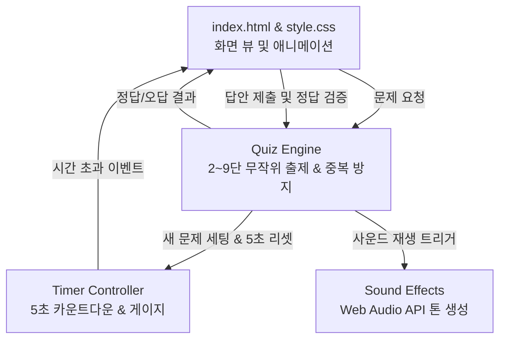

# 구구단 연습 게임 Implementation Plan

> **For agentic workers:** REQUIRED SUB-SKILL: Use superpowers:subagent-driven-development to implement this plan task-by-task. Steps use checkbox (`- [ ]`) syntax for tracking.

**Goal:** 초등학교 2학년 학생들을 위해 2단~9단 중 랜덤 문제 1개 출제, 5초 타이머 카운트다운, 정답/오답/시간초과 안내 피드백을 제공하는 경쾌하고 직관적인 단일 웹 애플리케이션 구축.

**Architecture:** HTML5, 모던 CSS3(플렉스박스/그리드, 둥근 카드형 UI, 애니메이션), 순수 Vanilla JavaScript(ES6+)로 구성. 오디오 파일 없이 Web Audio API를 활용해 정답 팡파레 및 오답 알림음을 자체 합성하여 외부 의존성 없이 로컬 브라우저에서 즉시 동작.

**Architecture Diagram:**

**Tech Stack:** HTML5, CSS3, JavaScript (ES6+), Web Audio API

**Spec:** `docs/superpowers/specs/2026-11-11-multiplication-game-design.md`

## Global Constraints

- 외부 라이브러리(CDN, npm) 의존 없이 순수 브라우저 표준 기술로 작성되어 오프라인 환경 및 파일 더블 클릭으로 완벽 구동되어야 함.
- 2단부터 9단까지 ($2 \times 1$ 부터 $9 \times 9$) 문제 랜덤 생성.
- 제한 시간은 정확히 5초이며 시각적인 게이지 바와 카운트다운 표시.
- 정답일 경우 "정답"을 크게 보여주고, 오답일 경우 "아쉬워요! 정답은 ___이에요."를 명확히 출력.
- 시간 초과 시 "시간 초과! 아쉬워요! 정답은 ___이에요." 안내 및 다음 문제 진행.

---

### Task 1: 핵심 구조 및 HTML 레이아웃 구축 (`index.html`)

**Files:**
- Create: `index.html`

- [ ] **Step 1: HTML 문서 골격 및 UI 요소 작성**
  - 제목, 스코어보드 (연속 정답/맞힌 개수)
  - 타이머 영역 (5초 텍스트, 프로그레스 바 게이지)
  - 문제 카드 ($A \times B = ?$)
  - 입력 폼 (숫자 입력창 `inputmode="numeric"`, '확인' 버튼)
  - 피드백 오버레이/메시지 카드 ("정답", "아쉬워요! 정답은 ___이에요.")
  - '다음 문제' 버튼 및 자동 진행 옵션

---

### Task 2: 초등 2학년 맞춤형 스타일링 및 애니메이션 (`style.css`)

**Files:**
- Create: `style.css`

- [ ] **Step 1: 아동 친화적 UI 디자인 구현**
  - 밝고 따뜻한 파스텔 배경, 둥근 모서리, 큰 폰트 크기
  - 타이머 게이지 바 전환 애니메이션 (5초 동안 매끄럽게 줄어듦)
  - 정답 팝업 애니메이션 (통통 튀는 bounce 효과)
  - 오답 시 카드 흔들림 (shake 효과)
  - 반응형 디자인 (모바일, 태블릿, PC 모두 적합)

---

### Task 3: 게임 로직, 타이머, 정답 판정 및 효과음 구현 (`app.js`)

**Files:**
- Create: `app.js`

- [ ] **Step 1: 구구단 문제 생성 및 검증 로직**
  - $2 \sim 9 \times 1 \sim 9$ 무작위 추출 및 직전 문제와 중복 방지
- [ ] **Step 2: 5초 정밀 타이머 제어**
  - 100ms 단위 타이머 갱신 (5.0초 ~ 0.0초) 및 프로그레스 바 너비 동기화
  - 5초 경과 시 타임아웃 처리
- [ ] **Step 3: Web Audio API 효과음 엔진**
  - 외부 음원 파일 없이 정답 상승 3화음(딩동댕) 및 오답 저음(퉁) 사운드 생성
- [ ] **Step 4: 정답/오답/시간초과 상태 처리 및 UI 연동**
  - 정답 시 대형 "🎉 정답!" 문구 노출 및 사운드 재생
  - 오답 및 시간초과 시 "아쉬워요! 정답은 [답]이에요." 노출
  - 자동 다음 문제 전환 (1.5초 딜레이) 또는 수동 클릭 지원

---

### Task 4: 브라우저 자동화 검증 (`browser-testing`) 및 최종 확인

**Files:**
- Test/Verify: `index.html` (브라우저 직접 구동 및 검증)

- [ ] **Step 1: 로컬 정적 서버 또는 파일 경로로 브라우저 열기**
- [ ] **Step 2: 문제 출제, 답안 입력 후 확인 버튼 클릭 테스트**
- [ ] **Step 3: 정답 표시 확인 ("정답") 및 오답 표시 확인 ("아쉬워요! 정답은 ___이에요.")**
- [ ] **Step 4: 5초 타이머 만료 시 시간초과 안내 정상 동작 확인**
- [ ] **Step 5: 스크린샷 캡처 및 최종 점검**
